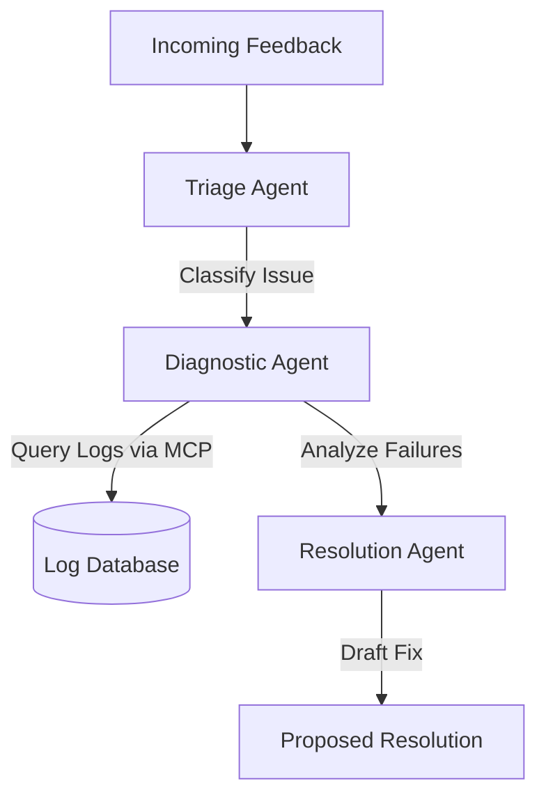

## The Problem
Manually triaging and resolving high-volume user feedback (Voice of Customer / VoCs) in a large ecosystem is time-consuming and error-prone. Response cycles are often delayed because engineers have to manually parse diagnostic logs, categorize issues, and search for appropriate troubleshooting guides.

## The Solution
We engineered an autonomous AI orchestration system that automatically ingests incoming customer feedback, extracts key semantic details, and triggers specialized agent workflows to triage, diagnose, and propose solutions.

## Architecture
The orchestration layer coordinates multiple independent agents with dedicated tasks:
- **Triage Agent**: Analyzes user sentiment and categorizes feedback.
- **Diagnostic Agent**: Connects via Model Context Protocol (MCP) to access anonymized backend logs.
- **Resolution Agent**: Synthesizes findings, drafts code fixes or configuration changes, and updates the support system.



## The Impact
- Drastically reduced **Mean Time To Resolution (MTTR)** for critical connectivity issues.
- Automated **80%+** of first-level diagnostic workflows, freeing up senior engineering time.
- Standardized logs analysis via self-improving prompt templates.

## Visual Proof
Here is a sample prompt template showing how we configure the Diagnostic Agent to securely query the Model Context Protocol (MCP) server for device telemetry:

```python
# telemetry_diagnostic_prompt.py
SYSTEM_PROMPT = """
You are an expert IoT Diagnostic Agent. Your role is to examine connection logs
from the client's gateway and determine if failures are due to:
1. Low RSSI (Signal Strength)
2. DHCP lease timeout
3. Firmware handshake mismatches

Use the `get_device_telemetry` tool to retrieve the logs for the given device ID.
Do not share any personally identifiable information (PII).
"""
```
