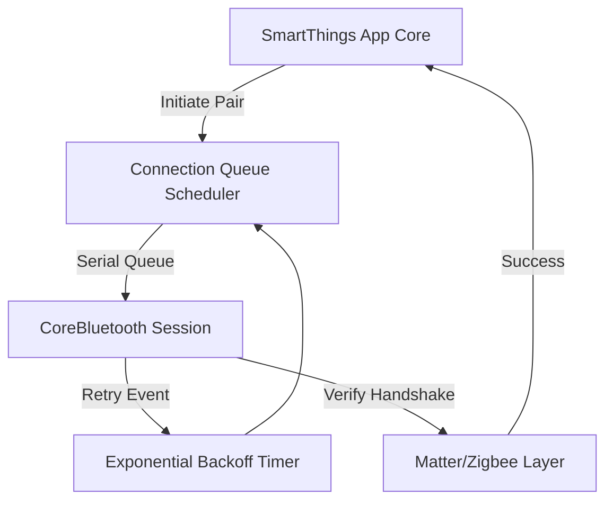

## The Problem
Wireless connection stability on client mobile apps is heavily affected by hardware diversity. In our smart home application, pairing success rates for BLE Hubs and hybrid Zigbee/BLE Smart Locks were low, due to inconsistent peripheral connection intervals, Bluetooth radio collisions, and poorly timed firmware handshakes.

## The Solution
We engineered a robust connection orchestration layer in Swift. By implementing customized connection priority parameters, adaptive retry strategies with exponential backoff, and isolating core BLE state transitions onto a dedicated serial dispatch queue, we maximized protocol reliability.

## Architecture
The layer handles low-level peripheral commands while maintaining state consistency via queue separation:



## The Impact
- Achieved an **88% connection success rate** for BLE Hubs (up from 65%).
- Raised hybrid Zigbee+BLE locks connection success rate to **73%** in noisy radio environments.
- Significantly decreased average connection setup times.

## Visual Proof
Here is the Swift implementation of our adaptive retry engine that handles CoreBluetooth disconnect callbacks with backoff:

```swift
// ConnectionRetryEngine.swift
import Foundation

public final class ConnectionRetryEngine {
    private let maxAttempts = 3
    private let baseDelay: TimeInterval = 1.0
    
    public func calculateDelay(forAttempt attempt: Int) -> TimeInterval {
        // Exponential backoff: baseDelay * 2^attempt + jitter
        let delay = baseDelay * pow(2.0, Double(attempt))
        let jitter = Double.random(in: 0.0...0.5)
        return delay + jitter
    }
    
    public func shouldRetry(attempt: Int, error: NSError) -> Bool {
        guard attempt < maxAttempts else { return false }
        
        // Retry on connection timeout or system collision errors
        let retryableCodes = [CBError.connectionTimeout.rawValue, CBError.operationCancelled.rawValue]
        return retryableCodes.contains(error.code)
    }
}
```
