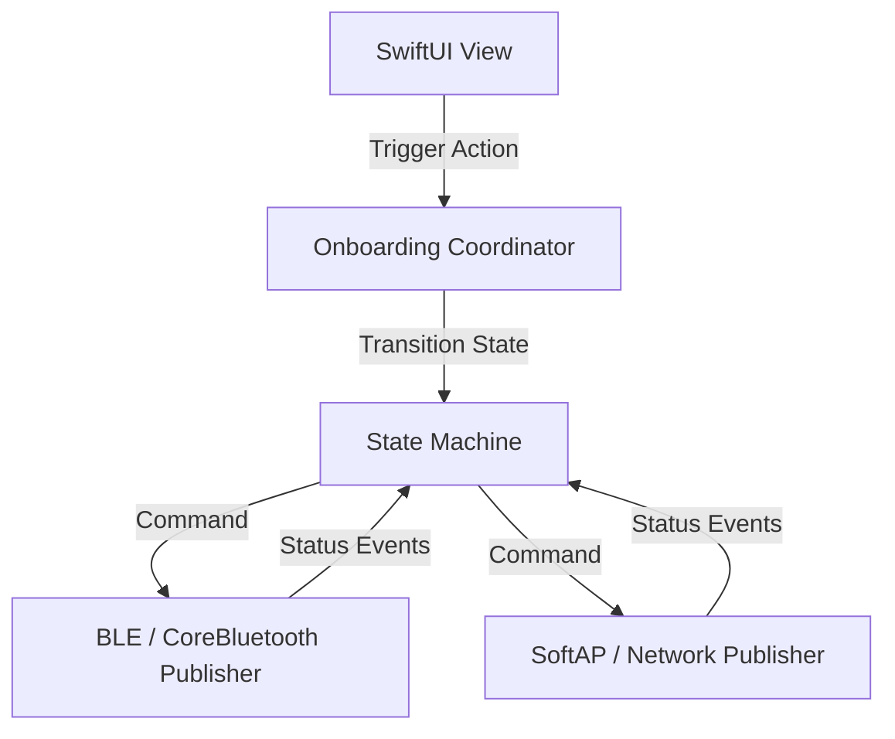

## The Problem
The legacy device onboarding ecosystem for Samsung SmartThings was built on `ReactiveSwift`, which increased compile times, bloated binary size, and became difficult to maintain alongside Apple's modern frameworks. The codebase spanned over 400 source files, and any migration risked breaking unstable onboarding flows for millions of active IoT devices.

## The Solution
We re-architected the entire mobile onboarding flow using Apple's native `Combine` framework. This involved converting all asynchronous event handling—from Bluetooth scanning (CoreBluetooth) to LAN setup (SoftAP)—into structured, native publishers.

## Architecture
The new onboarding architecture is built on state machines powered by Combine, decoupling UI updates from underlying transport layers:



## The Impact
- Completed migration across **400+ files** with **zero regressions** detected in production.
- Cut memory usage during BLE setup phases by **15%**.
- Reduced compile-time footprint of onboarding modules by **22%**.

## Visual Proof
Here is a representative code snippet of the Combine-based onboarding step coordinator, illustrating how we chained BLE scanning with device pairing:

```swift
// OnboardingCoordinator.swift
import Combine
import CoreBluetooth

public final class OnboardingCoordinator {
    private var cancellables = Set<AnyCancellable>()
    private let bleManager: BLEManager
    
    public init(bleManager: BLEManager) {
        self.bleManager = bleManager
    }
    
    public func startOnboarding(deviceId: UUID) -> AnyPublisher<OnboardingState, Error> {
        return bleManager.scanForDevice(id: deviceId)
            .flatMap { [weak self] peripheral -> AnyPublisher<Void, Error> in
                guard let self = self else { return Fail(error: OnboardingError.deallocated).eraseToAnyPublisher() }
                return self.bleManager.connect(to: peripheral)
            }
            .map { _ in OnboardingState.connected }
            .catch { error -> AnyPublisher<OnboardingState, Error> in
                return Just(OnboardingState.failed(error))
                    .setFailureType(to: Error.self)
                    .eraseToAnyPublisher()
            }
            .eraseToAnyPublisher()
    }
}
```
