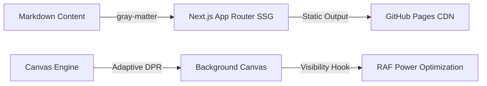

## The Problem
A personal portfolio is often the first touchpoint for recruiters and engineering leaders. If it feels generic, lacks quantitative impact metrics, or suffers from sluggish transitions, visitors quickly bounce. The challenge was building an interface that pairs high-fidelity visual design with technical substance, instant load times, and responsive mobile parity.

## The Solution
We engineered a high-performance portfolio using Next.js 16 (App Router), Turbopack, and Tailwind CSS 4. Beyond static pages, the platform features:
- **Interactive Multi-Scene AI Background Engine**: Procedural canvas rendering agent orchestration, high-dimensional vector embeddings, and diffusion denoising transitions based on scroll position.
- **Route-Aware Canvas Dimming**: Automatic watermark suppression on technical reading routes (`/blog/[slug]` and `/projects/[slug]`).
- **Tab Inactivity Power Optimization**: Visibility lifecycle hooks that immediately halt animation frames when the browser tab is idle or hidden.
- **Executive Overview Bento Grids**: Structured summary metrics (Role, Domain, Key Impact KPI, Core Tech) on all architectural case studies.

## Architecture
The static site generation pipeline processes Markdown case studies and blog posts with gray-matter at build time, yielding static assets deployed directly via GitHub Pages:



## The Impact
- **Sub-100ms First Contentful Paint** achieved through complete static generation (SSG) with zero backend runtime overhead.
- **0% Idle GPU/CPU drain** via automatic background suspension when the browser tab is inactive.
- **Flawless Mobile Parity** featuring continuous timeline rails, adaptive text sizing, and high-contrast light/dark themes.

## Visual Proof
The portfolio leverages hardware-accelerated transforms and Tailwind CSS for layered glassmorphism. Here is an example of the visibility change listener that stops unnecessary rendering cycles when the user navigates away:

```typescript
// BackgroundEngine.tsx
const handleVisibilityChange = () => {
  if (typeof document === 'undefined') return;
  isHidden = document.hidden;
  if (!isHidden) {
    lastTime = performance.now();
    animId = requestAnimationFrame(loop);
  } else {
    if (animId) cancelAnimationFrame(animId);
  }
};
document.addEventListener('visibilitychange', handleVisibilityChange);
```

