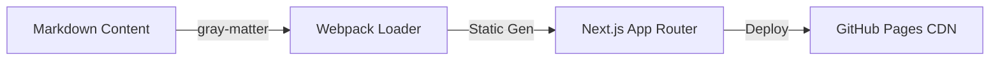

## The Problem
A personal portfolio is often the first touchpoint for recruiters and engineering managers. If it feels sluggish, generic, or lacks details about actual engineering architectures, visitors quickly lose interest. The goal was to build a highly responsive, custom-styled website that showcases technical competence, projects, and thought leadership.

## The Solution
We built a premium, fast, dark-mode-first portfolio using Next.js 16 (App Router) and Tailwind CSS 4. Instead of plain text summaries, we structured the project to read case studies directly from markdown files, enabling structured engineering writeups with embedded code snippets, diagrams, and formatting.

## Architecture
The static rendering pipeline retrieves Markdown files at build time, ensuring sub-second page loads:



## The Impact
- Under 100ms loading speeds due to fully static generation (SSG).
- Dynamic layout adjusts seamlessly from mobile screens up to desktop monitors.
- Markdown-driven blogging and case study workflow lets us add new content in minutes.

## Visual Proof
The portfolio leverages Tailwind CSS for styling and custom animations. Here is the custom glow animation setup defined in `globals.css`:

```css
@keyframes pulse-glow {
  0%, 100% {
    transform: translate(-50%, -50%) scale(1);
    opacity: 0.12;
  }
  50% {
    transform: translate(-50%, -50%) scale(1.08);
    opacity: 0.18;
  }
}
```
