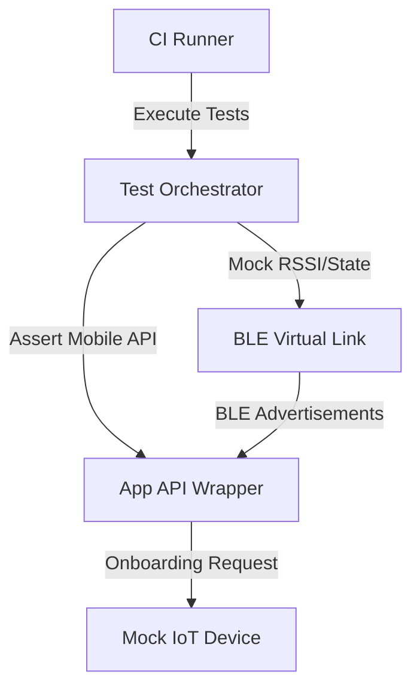

## The Problem
Testing device-to-device (D2D) communications locally requires developer setups with physical hardware (mobile devices, BLE gateways, smart plugs, and hub devices). Testing these combinations in standard CI/CD environments was historically impossible, leading to late-stage integration bugs and blocking rapid releases.

## The Solution
We engineered a remote D2D virtualization test framework in Python. The framework simulates device states, mocks low-level RF behaviors (attenuation, connection drops, protocol delays), and provides virtualized endpoints that integrate directly into cloud-hosted GitHub Actions or Jenkins runners.

## Architecture
The framework acts as an orchestration layer between virtualized firmware instances and mobile API clients:



## The Impact
- Completely **eliminated the need for physical hardware** in everyday code integration tests.
- Replaced manual regression testing with **nightly automated sweeps**, detecting regressions 5x faster.
- Boosted local developer onboarding speed since they no longer required specialized physical test labs.

## Visual Proof
Here is a simplified Python test case illustrating how developers write automated assertions for BLE packet drops using the framework:

```python
# test_ble_recovery.py
import pytest
from d2d_framework import VirtualLink, MobileClient, IoTDevice

def test_ble_reconnection_after_signal_drop():
    # 1. Initialize virtual link and devices
    link = VirtualLink()
    device = IoTDevice(name="SmartLock_V2")
    app = MobileClient()
    
    link.register(device)
    link.register(app)
    
    # 2. Establish connection
    app.connect_to(device)
    assert app.is_connected() is True
    
    # 3. Simulate extreme signal attenuation (packet drops)
    link.set_signal_strength(dbm=-100)  # Causes simulated drop
    assert app.wait_for_disconnect(timeout_sec=5) is True
    
    # 4. Restore signal and verify auto-reconnection logic
    link.set_signal_strength(dbm=-60)
    assert app.wait_for_reconnect(timeout_sec=10) is True
```
